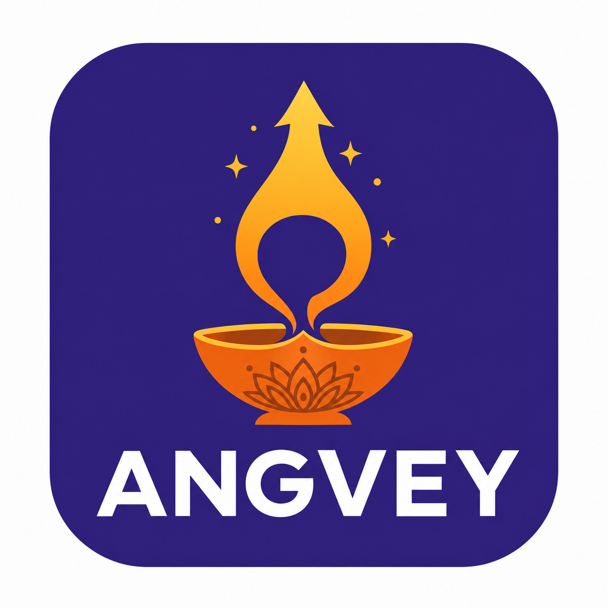

<div align="center">



# Angvey

**हर doubt का जवाब, अपनी भाषा में।**
_Voice-first AI study saathi for JEE, NEET & UPSC — built for Bharat, on open-source models._

[](http://localhost:8787)
[](LICENSE)
[](docs/MODELS.md)
[](#)

</div>

---

## The company

India has **2.5 crore+ competitive-exam aspirants**, and roughly **90% of the country does not
speak English fluently**. Every AI study tool they can reach is English-first, text-first and
₹500+/month. Angvey is the opposite:

| | |
| --- | --- |
| **Mission** | No student's rank should depend on their English. |
| **Product** | AI doubt saathi that answers in Hindi / Hinglish / English, by voice, grounded in NCERT. |
| **Price** | Free tier → **₹49/month** (Sahaj+) → ₹99 (Pro) → B2B white-label (Paathshala). |
| **Why we can price this** | Retrieval-first engine + self-hosted **open-weights** models ⇒ 70–85% gross margin. |
| **Where** | Sonipat, Haryana → Hindi belt → pan-India vernacular. |

📄 Read the founding research: **[docs/RESEARCH.md](docs/RESEARCH.md)**
· open-source model survey: **[docs/MODELS.md](docs/MODELS.md)**
· brand: **[docs/BRANDING.md](docs/BRANDING.md)**
· business model: **[docs/BUSINESS.md](docs/BUSINESS.md)**
· engineering: **[docs/ARCHITECTURE.md](docs/ARCHITECTURE.md)**

## What's in the app

| Surface | What it does |
| --- | --- |
| **💬 Doubt Saathi** | Ask a doubt by text or voice. Vey (the assistant) answers in your language mix, step-by-step, with the NCERT source cited. |
| **🎯 Practice Arena** | PYQ-pattern MCQs per subject with instant bilingual explanations. |
| **🗓️ Revision Planner** | 1-3-7-15 spaced repetition generated from your real accuracy — weak topics first. |
| **📊 My Dash** | Streak, accuracy by subject, 7-day activity, weak topics, doubt mix. |

### The two-tier engine (the cost moat)

```
doubt ──► Tier 1: bilingual TF-IDF retrieval over curated NCERT KB   (~80% of doubts, ₹0)
              │ no confident match
              ▼
          Tier 2: self-hosted open-weights LLM via Ollama (Qwen 3 / Gemma / DeepSeek)   (~20%)
```

Tier 1 works **with no GPU and no API key** — clone, run, and the app already answers
Hinglish doubts with cited NCERT content. Tier 2 is enabled by one env var.

## Quick start

```bash
# 1. API (Tier-1 only — no GPU, no keys)
cd server && npm install && npm start          # http://localhost:8787

# 2. Web app (in another terminal)
cd web && npm install && npm run dev           # http://localhost:5173 (proxies /api)

# 3. Production: build the web app, then the API serves it on one port
cd web && npm run build && cd ../server && npm start   # http://localhost:8787
```

### Enable the open-weights LLM (optional, Tier 2)

```bash
ollama pull qwen3:8b

cd server
OLLAMA_URL=http://localhost:11434 OLLAMA_MODEL=qwen3:8b npm start
```

Any OpenAI-compatible / Ollama endpoint works. If it is unreachable, Angvey silently
falls back to Tier-1 retrieval — students never see an error.

### Docker (full stack)

```bash
docker compose up          # api + web build + ollama with qwen3:8b pulled
```

## Project layout

```
brand/                 logo + brand assets
docs/                  research, models, branding, business, architecture
server/                Express API + Doubt Engine (plain Node, no build step)
  src/engine/          hinglish normalizer · retriever · doubt engine · LLM adapter
  src/data/knowledge/  bilingual NCERT-grounded KB (one JSON per subject)
  src/data/questions.json  PYQ-pattern MCQ bank
  src/routes/          chat · practice · progress · planner
  src/store/           atomic JSON persistence (swap for SQLite/Postgres later)
web/                   React 18 + Vite + TypeScript SPA
  src/pages/           Landing · Chat · Practice · Planner · Dash
  src/lib/             typed API client · Web Speech wrappers
```

## API reference

| Method | Route | Purpose |
| --- | --- | --- |
| `GET` | `/api/health` | service status + engine stats |
| `GET` | `/api/brand` | marketing copy + plans (single source of truth) |
| `POST` | `/api/chat` | `{ message, lang }` → bilingual answer, steps, source, related topics |
| `GET`/`DELETE` | `/api/chat/history` | conversation history |
| `GET` | `/api/practice/subjects` | subject cards with counts |
| `GET` | `/api/practice/questions` | filtered question set (answers withheld) |
| `POST` | `/api/practice/answer` | grade an answer, return explanation |
| `GET` | `/api/progress` | streak, accuracy, weak topics, 7-day activity |
| `PATCH` | `/api/progress/profile` | name / exam |
| `GET` | `/api/planner` | spaced-repetition plan |
| `POST` | `/api/planner/complete` | mark a task done |

Anonymous, device-scoped identity via the `x-angvey-user` header — no login wall on the free tier.

## Tests

```bash
cd server && npm test        # engine + retrieval regression suite
```

## Open-source stack

Qwen 3 (Apache 2.0) · DeepSeek R1 (MIT) · Gemma 4 (Apache 2.0) · Whisper / faster-whisper (MIT)
· AI4Bharat IndicConformer · Ollama · vLLM · FAISS · React · Vite · Express.
Full evaluation and licensing notes: [docs/MODELS.md](docs/MODELS.md).

## Roadmap

- [ ] Self-hosted Whisper/IndicConformer STT for dialect accents (Haryanvi, Bhojpuri)
- [ ] Photo-a-doubt OCR (Gemma 3 vision) for handwritten questions
- [ ] 8 more Indic languages via AI4Bharat + Bhashini
- [ ] Paathshala white-label console for coaching institutes
- [ ] SQLite/Postgres store adapter + parent/teacher reports

## License

[MIT](LICENSE) © 2026 Angvey Technologies, Sonipat, Haryana.
